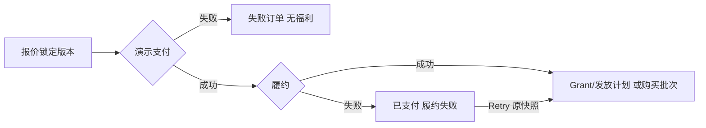

# SunnyFit 3.0 商业化原型：开发交付说明

## 2026-10-14 最新 Confluence 定义对齐

当前交付以 Entitlement Item List v10、关联管理定义 v3 和 AI Weekly Report PRD v8 为准。完整业务对应、页面入口、验证和待定项见[最新原型交付](SunnyFit_V3_Optimized_Demo_Handoff.md#2026-10-14-最新定义与商业化页面接入)。MVP 明确为五项内容权益、三项功能权益、AI Coach / Content 两种额度；Human Coach 不在本轮范围。

本轮已经确认 AI User Turn、功能零扣额、Content 永久解锁、原订阅时区月度刷新且不结转，以及 Base / Additional 访问权并集。后台目录、Suit 动态字段、服务规则、内容映射、商品、用户钱包、发放排期、订单快照和业务关系图同步更新。下方早期记录中将整个 Additional 合并或所有服务单位列为未定义的说法已被这些确认规则覆盖；具体价格、数量和更细合并规则继续保持 Open。

## 2026-10-14：图形化需求评审

[业务关系图](http://127.0.0.1:3012/?build=business-review#/commercialization/overview?tab=logic)位于现有 Review Tools → Demo Overview 的“业务关系图”Tab，保留“场景与数据”和已有 Flow Preview 入口。没有增加生产业务菜单。评审顺序为：权益类型、权益关系、权益组合、内容授权、套餐与订单、额度与消费、版本与待定。

节点可点击或用 Enter / Space 选择。图下方的“当前节点”卡片以中文名称为主，英文名称供对照；按一句话定义、具体例子、关键规则、对应原型页面组织说明。规则使用业务动作说明，例如“每月增加一笔额度，不清掉自购余额”；待定节点直接说明还需要确认的问题。关系表补充一对多、唯一归属、类型隔离等语义。已确认、Open 和历史兼容有文本与图形标记。未定义的服务单位、Additional 合并、主动取消退款、兑换内容下架、用户流水展示仍保持 Open；旧购买快照不会被作为新模型示例重解释。

“核对当前 Demo 配置”读取真实目录、Scope、Suit、Product / SKU 和订单快照。旧 Suit 明确标记为历史模型；没有订单时显示空状态，不为了关系图创建购买。大屏演示提供画布缩放、键盘焦点约束和 Esc 返回；切换场景 Tab 保留当前评审节点，不新增同名页面标签。可复制含主题 / 节点的链接，或导出有图例的独立 SVG，用于需求稿和会议材料。

图形与业务定义集中维护在 `src/components/BusinessReview/model.cjs`，展示位于同目录 `index.vue`。新规则调整需同步定义和实际业务实现；评审视图本身不写配置、不发授权、不创建订单或消费额度。

`npm run build` 和 `npm run test:business-review` 已通过。[10 项浏览器校验](business-review-validation/2026-10-14T11-40-52-662Z/results.json)覆盖七主题节点、文字边界、链接还原、键盘选择、七张独立 SVG、大屏模式、Open 状态、旧概览保留、760 / 1024 / 1440 窗口和业务数据未改变。当前节点说明更新后，另在主 Demo 查看权益组合、额度发放、发放规则、购买内容和主动取消待定说明，并截图核对 1440 / 760 窗口下的阅读效果。可直接查看[额度发放规则说明](http://127.0.0.1:3012/?build=node-readable#/commercialization/overview?tab=logic&topic=composition&node=grant_rule)、[套餐与订单图](http://127.0.0.1:3012/?build=business-review#/commercialization/overview?tab=logic&topic=orders&node=order)或[版本与待定图](http://127.0.0.1:3012/?build=business-review#/commercialization/overview?tab=logic&topic=versions&node=legacy)。

## 2026-10-14：三类权益模型为当前基准

本节覆盖下方早期 `Scope + Quota` 和只调整 `Default` 标签的方案。新写入的 Suit 使用 `modelVersion: 2`；没有版本标记的已发布配置、购买记录和授权按历史模型读取。

| 权益类型 | 配置 | 实际执行 |
| --- | --- | --- |
| Content Access | 每个内容唯一 `contentScope`；Suit 多选明确 Scope code | 访问检查真实映射；不以商业标签代替 Scope。选择全部保存当前具体范围，新增 Scope 不自动授权 |
| Feature Access | 加入 Item，无 Scope、Quota、Access 开关 | 持有该 Item 即具备功能访问权；读取历史资产沿用现有逻辑 |
| Consumable Credits | Credit Type、Amount、Grant Rule、Expiration | 会员、购买、活动和补偿产生独立批次；按类型核算余额和流水，类型间不互付 |

内容 Scope 在现有 Content Commercialization 的 **Content Scopes** 弹窗维护，没有新增侧栏入口。当前初始化范围沿用已存在的内容池并为旧 Premium 内容建立明确范围；Beginner / Strength 等例举分类没有被当作生产分类自动建立。新内容版本必须选择一个 Scope。停用 Scope 停止新选择，历史访问权不通过停用操作自动撤销。

新套餐的配置按类型动态展示，旧功能使用次数保留在旧购买快照。旧套餐进入配置页时显示升级预览；单纯查看不会保存或发布，发布下一版本才供后续购买使用。基础免费训练仍由系统 Free 权益保障。

Credit Type 注册表提供 AI_COACH_CREDIT、HUMAN_COACH_CREDIT、CONTENT_CREDIT 三个本轮示例类型。它们表示可消费资产，真人服务或各服务的定价并未因此开通。旧通用批次标记为内部 LEGACY_CREDIT，金额、原期限、订单和 Grant 不拆分、不复制、不重写。新额度商品选择一个类型，新自购额度不设置到期时间；会员结束不清空购买余额。

Monthly 是定期新增 Grant，不是重置整只钱包。每笔 Grant 可独立选择会员周期结束、发放周期结束、固定天数或永久有效。消费先限定 Credit Type，再按最早到期顺序选择有效批次，无到期批次最后使用。Grant / Consume / Refund / Expire 账务在 SQLite 事务内执行；重复请求幂等。Refund 只提供内部账务撤销能力，保留原批次期限，没有实现用户主动取消退款流程。

以下规则保持 Open：Additional Suit Merge Rule、各服务具体 Credit 消耗单位、用户主动取消是否退款、已兑换内容下架处理、用户是否展示 Credit Transaction。新 Additional Suit 的运行时发放暂不执行未定义合并；新模型服务和新映射精品内容的消费规则未定义时不给报价、不预留、不扣款。旧服务价格仅为历史 Demo 参数。既有用户流水入口只展示旧通用额度，没有加入新类型流水的用户入口。Text / Image / Live 保留为旧服务交互模式，没有新增三个 Feature 或 Credit Type。

验证：`npm test` 的 37 项测试通过，含 14 项新模型测试和 23 项历史兼容回归；[后台交互回归](prototype-previews/browser-check.json)、[前台 23 项回归](optimized-demo-validation/2026-10-14T10-29-27-770Z-e9cddd/results.json)、[新模型 8 项浏览器验证](entitlement-model-validation/2026-10-14T10-43-16-424Z/results.json)通过。新浏览器验证中的 100 / 20 / 40 等数值仅是隔离库测试样例，不写入主 Demo，不是确定的发放数量、消费单位或售卖价格。

[打开新目录](http://127.0.0.1:3012/?build=typed-entitlements#/commercialization/catalog)，[查看套餐升级表单](http://127.0.0.1:3012/?build=typed-entitlements#/commercialization/suits/premium)，[维护内容 Scope](http://127.0.0.1:3012/?build=typed-entitlements#/commercialization/content)。

## 早期记录：单一 Scope 显示 Default（已由三类权益模型覆盖）

按本次业务澄清保留当前 Scope 定义。配置表单、已发布快照、服务配置摘要和用户有效权益对原定义只有一个支持范围的权益显示 `Default`。这里判断的是支持范围数量，不是用户当前只勾选一项。多范围配置继续保留原具体选项、多选及 ALL 互斥规则。

目录列表和 View 详情另按目录展示规则去掉 `ALL` 标签：多个具体范围逐项列出；只有一种具体范围或没有细分范围时显示 `Default`，悬停可查看原范围名称。Course Access 显示 YouTube / Free Content，AI Coach Chat 显示 Text / Image / Live，其余五项显示 Default。先前只验证单一范围的三项，漏掉多范围项目残留的 ALL；本次已补核所有七项列表及七个详情。[15 项运行页面与数据核验](admin-scope-validation/catalog-scope-fix/results.json)通过。目录展示不替换套餐保存值，也不修改权限判断。

`Default` 仅为展示名称，配置与授权仍保存原代码；没有引入新的 Premium Scope，没有改动权限判断、目录接口或历史授权。目录格式化与选择值分离，未知旧值仍直接显示，避免被误标为 Default。

[打开权益配置](http://127.0.0.1:3012/?build=scope-default#/commercialization/suits/premium)，或查看[权益目录](http://127.0.0.1:3012/?build=scope-default#/commercialization/catalog)。[5 项展示与数据核验](admin-scope-validation/2026-10-14T06-30-29-959Z/results.json)和[既有后台回归](prototype-previews/browser-check.json)通过；后者在隔离 SQLite 中验证目录、ALL 互斥、草稿、发布、旧授权快照及删除保护。

最新交付：2026-10-12 的会员包含用量、额外余额和订阅流程更新见 [优化版 Demo 交付说明](SunnyFit_V3_Optimized_Demo_Handoff.md)。本说明保留早期页面与接口背景；当前行为、入口及测试命令以优化版说明为准。

更新：2026-10-10。后台与 App 样稿。业务基准：[规则与实施计划](SunnyFit_V3_Commercialization_Rules_And_Plan.md)。本文件以当前代码为准，替代第一批两模块的交付说明。Demo 页面数量不等于正式新增页面数量；实施位置以本节清单为准。

## 1. 交付和复用

后台：`http://127.0.0.1:3011/#/commercialization/overview`；App：`http://127.0.0.1:3011/#/app/home`。

Vue 2.6.10 / Element UI 2.15.14 / Router 3.1.0 与现有后台发布资源一致，采用对应目录外壳、hash 路由及 `meta.perms`。没有原后台源码或登录会话，因此不能保证构建、所有主题参数及权限实现完全相同。

迁入原项目：

1. 按下方实施位置提取业务表单、Tab、表格及 `components/Commerce`、`CommerceSummary`、`AdminNumber` 和业务 API。不要整包复制所有 Demo 页面作为新模块。
2. 新模块复用原 Layout、request、依赖和登录权限；现有模块直接增加对应字段、组件和操作。
3. 当前 API 解包 `response.data.data`；正式响应不同，由适配层转换。只注册实际新增的业务路由及权限，原模块扩展沿用对应入口。原型路由标记 `prototypeOnly` 仅说明交付范围，不替代服务端鉴权。
4. Node/SQLite 是可运行的业务契约参考，正式后端技术沿用现有项目。
5. App 是移动网页样稿；复用流程、文案、样式值及契约，原生组件按现有 App 技术实现。

### 1.1 正式实施位置与评审工具

当前原型侧栏的分组用于说明开发位置，不是原后台已经存在这些分组的证据，也不是最终生产菜单。每页上方的中文实施位置为评审注释，正式产品不展示。

| Demo 页面 / 能力 | 实施类型 | 正式落点 |
| --- | --- | --- |
| Entitlement Catalog / Suits | 建议新增权益管理 | Catalog 为只读子页，Suits 为套餐配置；两者同属一个管理模块 |
| Products 与内嵌 SKU | 建议新增商业商品管理 | 会员 / Credits 商品配置；若已有商业商品模块则扩展，不另建 SKU 一级菜单 |
| Service Pricing | 建议新增配置能力 | 服务动作、权限、Credits 计价和版本；可并入商业化配置，独立菜单并非必须 |
| Content Labels | 扩展现有内容管理 | 在课程、World Tour、现有 Training Program 列表及编辑页增加标签、兑换价格、有效期、筛选与批量操作。Demo 的统一内容列表只为集中评审，不要求新增第二套内容库 |
| User Rights / Credits Wallets / Ledger | 扩展现有用户详情 | 增加权益、余额、批次及流水 Tab；Demo 用户列表只是原用户管理的商业化信息样例，不取代原资料页面。取消独立 Wallets / Ledger 侧栏入口 |
| Orders / Subscriptions | 复用交易与订阅管理 | 加商品类型、购买快照、权益版本、支付 / 履约状态及补发；后台续订操作需结合现有商店能力确定。原后台没有对应模块时才新增 |
| Redemptions / Service Requests | 必需的记录能力，页面可嵌入 | 放在用户详情和对应内容 / 消费详情；独立全量查询页保留为辅助样例，不要求各建一级菜单 |
| Audit Log | 必需的审计事件，复用日志 | 商业化配置和履约事件写入原操作日志；Demo 全量列表只是追溯样例 |
| Campaigns / Delivery Records | 可选运营方案 | 非购买发放及补偿能力可复用原活动 / 客服功能；独立活动配置模块不是已确认六条商业规则直接要求的范围。发放记录挂在对应操作下 |
| Overview / Flow Preview | 仅评审工具 | 不属于本期正式后台新增页面。场景用户、演示支付、强制到期、人工完成 / 释放请求均用于本地评审 |
| 交互说明、App Samples、实施位置提示 | 交付注释和评审入口 | 不进入生产产品界面；业务字段提示、校验、成功 / 失败反馈保留 |

模拟 Purchase Preview、Open App 已从业务用户详情和订单列表移到 Review Tools；人工 Complete / Release 已从服务记录表移除，在 Flow Preview 演示。正式服务状态由后端回调及超时任务推进。真实订单失败补发仍属于管理能力，需要原后台权限控制。

**开发范围按能力和原模块改造项估算，不能按 Demo 的独立路由数估算。** 当前未取得原后台源码及完整菜单；模块落点是基于已知结构的实施建议，接入时核实原菜单 / 字段，复用已有能力。

## 2. 已确认规则

| 已确认 | 当前执行行为 |
| --- | --- |
| 会员和 Credits 独立，会员可附赠 | 会员生成版本化 Grant；福利独立生成批次/发放计划；Credits 商品只发批次 |
| 精品独立兑换/购买 | Featured 查独立兑换，会员 ALL 不绕过；演示采用 Credits 兑换 |
| 可直接加购，有效期区分 | Credits 商品单独配数量和有效期，任何会员状态都可购买 |
| 叠加、独立到期、先到期使用 | 可用额为未到期批次 remaining-reserved 之和，按到期/发放时间/ID 排序分配 |
| 已购周期旧规则，新购买新规则 | 不可变发布版本；报价锁定商品/SKU/Suit；支付前变更重新报价，已支付仍用原快照 |
| 到期保留已有资产 | 回落 Free，新操作重新检查；旧对话/报告/计划可读，有效独立兑换仍有效 |

### 演示政策，尚非生产决策

- 价格、数量、期限见 `config/demo-policy.cjs` 和初始 Suit。后台发布可修改，重启不覆盖。
- 服务按一次用户操作固定 Credits 计价，内部调用不另扣；报价 5 分钟、预留租约 10 分钟。
- 新增会员周期排在已购周期后，也可配置期间禁止购买；即时升级、退款、宽限期和平台续费需另定。
- billing_cycle / one_time 每个新 Grant 开始时发一次；monthly 按开始日逐月发放，短月取该月最后一天，每批独立期限。
- **课程包为现有 Training Program**。本稿分别检查 Program Select 与包内 Workout Start，Program 兑换不自动兑换包内 Featured。组合授权仍待评审。已兑换 Program 保留兑换时的包内列表，包内 Start 独立检查当前课程权益。
- Free 默认权限迁移、Star 迁移、退款对已消费/兑换资产的处理需正式方案。

## 3. 配置与内容管理

| 模块 | 关键约束 | 发布影响 |
| --- | --- | --- |
| Catalog | 系统只读；能力及允许 Scope | 不能临时创建能力 |
| Suits | Base/Additional 固定；Free 保护；Items/Scope/福利 | 新授权新版本，旧 Grant 保留 |
| Products | 会员关联非 Free Base；Credits 正整数/期限；内嵌 SKU | 新购买新版本，已支付快照保留 |
| Content Labels | Course→course_access；World Tour→world_tour_access；Training Program→training_program_access | 新 Start/Select 用当前标签，旧兑换期限保留 |
| Service Pricing | 能力+Scope+Credits；plan_activate 固定 Dynamic Plan/ALL 与 0 Credits | 进行中请求不改价 |
| Campaigns | 仅授予 Additional；另发 Credits；窗口/上限/去重 | 已发授权/批次不变 |

共同字段：name 1–80 字，code 唯一、3–64 小写字母/数字/下划线且字母开头，description ≤1,000，Active/Disabled。code 创建后固定。额度为整数 ≤1,000,000，天数 1–3,650。SKU 价格使用整数最小货币单位，界面金额换算；已发布 id/channel/storeCode 固定，只能停用旧映射再加新 SKU。

Suit 的 ALL 与具体 Scope 互斥；功能 Quota 不存钱包余额。Program 引用已发布独立课程/实景，不嵌套 Program。Featured 配正数兑换 Credits、无期限或指定天数。

**草稿流程：**编辑 → Save Draft → Preview Changes → Publish。未保存不能发布；历史只读；有发布版本可 Discard Draft；未发布配置可删除，Suit 仍受历史引用保护。离开/切换详情/刷新保护未保存编辑。

revision 是并发写标记，publishedVersion 是业务版本。保存只增加 revision；发布原子写快照、切指针、清草稿和记审计。409 保留编辑，Reload 前确认。

**批量内容：**只统一修改标签、价格及期限并保存草稿，保留其他已有草稿字段；逐条查看后 Publish Selected Drafts。发布包含所选记录的全部已保存草稿字段。任一冲突、无草稿或无效，整批回滚。

## 4. 用户、钱包与资产

有效权益是一个 Base 加所有有效 Additional，按能力合并 Scope，ALL 覆盖局部范围。来源显示 Grant/Suit 版本和期限；到期使用有效 Free Grant 或系统默认。

批次保留 original/remaining/reserved/issuedAt/expiresAt/source/sourceId；可用与预留分开。补偿填原因，新建批次，不改购买批次。计划发放按购买时福利配置执行。

| 事件 | 含义 |
| --- | --- |
| GRANT | 新发入账 |
| RESERVE | 占用可用余额，尚非消费 |
| SPEND | 成功结算/兑换的消费 |
| RELEASE | 释放预留，已过期批次不恢复有效期 |
| EXPIRE | 移除到期未预留剩余 |

消费统计只累计 SPEND，不能重复累计 RESERVE。详情展示跨批次分配及业务引用。批次在预留中到期，只移除未占用部分；占用在租约内可结算，失败释放后过期处理。

已有资产读取不查会员/额度，不发起新计费。新生成、重新分析、激活走新使用。Premium 播放历史不等于独立购买，再次 Start 查当前权益。

## 5. 支付、履约和订阅

订单分开记录 status: paid/failed 与 fulfillment: completed/failed/pending/not_started。重试只处理已支付未完成订单，不重复发放。周期冲突提示处理，不覆盖已有周期。取消/恢复续订填原因，当前周期不缩短；过期不能恢复旧周期。

原型不运行自动扣款或商店回调；正式接入需要交易号、验签、持久幂等和退款状态。资金流水及对账继续使用原模块。

## 6. 服务和兑换

功能权益 → Credits 足额 → 报价 → 预留 → 成功消费/保存资产，失败释放。reserved 才能完成；completed/failed/expired 是终态，重复回调不重复收费。进行中请求保持原价格。

plan_preview 检查聊天授权且耗 Credits；已有 plan 激活检查 Dynamic Plan，价格 0，不产生新 LLM。演示结果是本地适配器，可模拟失败。

Free 按内容池查 free_content，Course 也支持 youtube；Premium 查 ALL；Featured 查兑换。停用内容停止新访问，历史记录保留。兑换锁定内容版本/价格/期限；有效兑换先返回已有权益，再次播放不收费。legacy_star 仅是历史来源样例，未执行真实迁移。

写请求带稳定 requestKey；服务端持久化种类、参数摘要和结果。相同请求重试返回原结果，同 key 不同参数报 REQUEST_KEY_REUSED。适用于购买、服务、兑换、补偿和活动。

## 7. 发放与审计

Campaign 按 campaign/user 去重；Compensation 按 campaign/case/user 去重。必须选用户、填原因，补偿填案件编号。重复对象 Skipped；全部先校验再事务发放，失败整次回滚。

所选 Additional 自带福利和活动 extra Credits 分别发放、各自追溯。记录发布版本、接收人、Grant/batch 及结果。

审计覆盖配置、支付、履约、额度、服务及演示到期。Demo Admin 为操作者占位，payload.userId 是业务主体；生产需接真实身份/权限/来源。

## 8. API 契约

前缀 `/api/commercialization`。成功 `{code:20000,data}`；失败为相应 HTTP 状态及 `{code,reason,message,fields}`。资格不足返回正常判定 allowed:false；写入不足/报价变化返回 409。

| 方法与相对路径 | 输入/用途 |
| --- | --- |
| GET /catalog、/suits、/suits/{id} | 原目录、套餐与 impact/history/preview/publish/discard 契约保留 |
| GET/POST /{entity} | products/content/pricing/campaigns 列表 / Config 新建草稿 |
| GET/PUT/DELETE /{entity}/{id} | 详情 / {config,revision} 保存 / {revision} 删除未发布草稿 |
| GET /{entity}/{id}/history | 不可变历史 |
| POST /{entity}/{id}/preview | {config} → 差异、交易数及保留策略 |
| POST /{entity}/{id}/publish、/discard | {revision} → 当前详情 |
| POST /content-bulk | {action:save/publish,items:[{id,revision}],tier,redemptionCredits,redemptionValidityDays} |
| GET /overview、/users、/users/{id} | 概览、权益钱包、用户授权/资产/交易 |
| GET /ledger、/orders、/subscriptions、/redemptions、/usage、/campaign-runs、/audit | 列表；query userId/status/type/search；生产改服务端分页 |
| GET /orders/{id} | 商品/SKU/Suit 购买快照 |
| GET /storefront/{userId} | App 权益、钱包、发布商品/福利、内容判定、服务、资产 |
| GET /users/{id}/assets/{assetId} | 免费读取已有结果 |
| POST /access | {userId,serviceId} 或 {userId,contentId} |
| POST /purchase-quote | {userId,productId,skuId} → 版本、金额、日期 |
| POST /purchase | {userId,quoteId,requestKey,outcome?}，outcome 仅后台模拟 |
| POST /orders/{id}/retry | 已支付快照补发 |
| POST /subscriptions/{id}/renewal | {enabled,reason} |
| POST /service-quote | {userId,serviceId,assetId?} → {decision,quote} |
| POST /service-start | {userId,quoteId,requestKey,message?} → reserved |
| POST /usage/{id}/finish | {outcome:succeeded/failed} |
| POST /redemption-quote | {userId,contentId} → 已有兑换/不足/报价 |
| POST /redeem | {userId,quoteId,requestKey} |
| POST /compensate | {userId,amount,validityDays,reason,requestKey} |
| POST /campaign-run | {campaignId,userIds,caseRef?,reason,requestKey} |
| POST /demo-expire | {userId,batchId?}，仅演示工具 |

主要 reason：ENTITLEMENT_REQUIRED、CREDITS_INSUFFICIENT、REDEMPTION_REQUIRED、CONTENT_UNAVAILABLE、CONFIG_CHANGED、QUOTE_STALE、QUOTE_EXPIRED、REQUEST_KEY_REUSED、FULFILLMENT_CONFLICT。逐项表单校验用 fields，不把失败显示成成功。

## 9. App 页面还原、入口和新增方案

本轮修订替代上一版 Me / Explore 聚合页面与 Coach 功能 Tab。此前引用的 Alpha 249:2123、249:2183、250:2616 在当前文件中无法核实，不继续作为设计依据。

### 可读取的页面与真实入口

| 样稿 / 路由 | 设计依据 | 入口及商业化逻辑 |
| --- | --- | --- |
| Home /app/home | [MVP 151:7558](https://www.figma.com/design/94S2EVx6mOkJRj8P0VyRLx/V3.0-MVP?node-id=151-7558) | 保留 Home / Workout / Challenge / Social 和独立 AI 图标；Plan 进入当前计划，Start Now 检查推荐课程授权 |
| Workout /app/workout | [MVP 199:3012](https://www.figma.com/design/94S2EVx6mOkJRj8P0VyRLx/V3.0-MVP?node-id=199-3012) | 保留 Course / World Tour / Free Mode，轮播、14 个分类和原底栏。此稿覆盖 Course 首屏，GO 检查课程授权 |
| Courses /app/course | [SUNNYFIT 6006:28045](https://www.figma.com/design/Q2YjFPNeavj0zS6pHpr5Lk/SUNNYFIT?node-id=6006-28045) | 从引导底稿去掉教学遮罩，保留图片、教练信息、Invite / Calendar / Favorite、Warmup / Cooldown、Start。受限发生在 Start |
| Training Program /app/program | [Alpha 1:4521](https://www.figma.com/design/t7g261XYs61EdvYzIZn5YL/V3.0-Alpha?node-id=1-4521) | 原“有课程包计划”首页状态。保留进度、Start Now、Course2；不是新增 Programs Tab。Start 先查 Program，再查当前子课程 |
| AI Coach /app/coach | [MVP 864:2803](https://www.figma.com/design/94S2EVx6mOkJRj8P0VyRLx/V3.0-MVP?node-id=864-2803)、初始态 864:2747 | 原工具栏（新对话 / 历史 / 关闭）、蓝色用户气泡、玻璃回复和底部输入。Send 调用普通聊天计价；没有 Chat / Deep Insight / Plan 切换 |
| Workout Data /app/result | [Alpha 9:1507](https://www.figma.com/design/t7g261XYs61EdvYzIZn5YL/V3.0-Alpha?node-id=9-1507) | 指标 / RPE / 已有 Coach Insight 可读；新生成检查 workout_result_ai_insight + Credits。原 Ask Coach 进入普通聊天，带本次运动上下文 |
| Plan /app/plan | [Alpha 10:2622](https://www.figma.com/design/t7g261XYs61EdvYzIZn5YL/V3.0-Alpha?node-id=10-2622) | 当前计划、阶段、Next 5 Days、From Coach、GO、Change workout、Adjust today。旧计划可读；GO 按课程授权；Adjust today 先查 Dynamic Plan 再进入聊天 |
| History /app/history | [MVP 864:3497](https://www.figma.com/design/94S2EVx6mOkJRj8P0VyRLx/V3.0-MVP?node-id=864-3497) | AI Coach 顶部历史图标进入；从 API 读取已有 conversation 资产，免费阅读。继续发送作为新请求 |
| Membership /app/membership | 本次新增方案 | 当前购买周期、发布权益、报价/确认、续订。可由权益受限弹窗进入 |
| My Credits /app/wallet | 本次新增方案 | 可用/预留、最近到期、独立批次、直接购买、账本。可由额度受限弹窗或聊天新增余额提示进入 |

### 原页面和本次新增的边界

- 原图片、分类图标、工具栏图标、背景 SVG 和 AI 小图标均保存在 public/assets/figma/restored。AI 图标导出的是完整图形资产，页面截图只用于对照，不作页面背景。
- 首页和课程新增 Free / Premium / Featured 标记；AI Coach 新增余额与单次用量提示；Coach Insight 新增“生成/重新生成”状态和价格提示。这些位置为本次商业化方案，左侧开关可隐藏新增标记以核对基础 UI。
- 会员、钱包、报价确认、兑换确认和两类受限弹窗为新增方案。采用原稿的 16/24 正文、18/26 按钮、12 px 卡片、红 CTA 与浅色玻璃样式；没有声称这些新增页已经与既有会员页面逐像素一致。
- 初始聊天依据 864:2747 的渐变问候。网页使用真实输入框，不绘制 Figma 中的 iOS 键盘；原稿示例对话可从评审工具开启。
- 当前 Plan 原稿是已经激活的训练日状态。没有在此插入不存在的 Activate 按钮；计划预览 / 激活入口的具体设计仍需补齐。
- 会员或额度到期只拦截新请求。历史对话、已有分析、已有计划可以读取；Ask Coach 属于新聊天，仍需 Credits。
- 内容 Start 授权通过后，实际 App 应接现有播放器。本稿只演示入口判定，在手机外显示判定结果，不制造新的训练记录或直接假装训练完成。
- Program 先判断包、再判断子课程仍是待确认的组合授权方案；已兑 Program 保留成员快照。界面和兑换确认中都标注子课程可能需要独立授权。

### 演示数据和交互状态

左侧用户/内容选择器、逻辑注释、失败开关和 API 刷新均属于评审工具，不进入产品 UI。封面与设计示例标题保持原稿，所选 Course / Program ID 只演示后台标记与授权，不代表已经与线上内容 ID 对接。Home 的 Workout、Challenge、Social 等现有内容没有被指向虚构模块。

普通聊天从 Send 报价；深入分析从 Workout Data 的生成按钮报价。先检查功能权益，再检查可用 Credits。确认后预留，成功结算并保存对应资产，失败释放。新生成分析展示实际保存的本地适配器结果，不用设计示例分析假冒 LLM 输出。

受限弹窗 → 会员或钱包 → 返回原页面。输入按用户保存在 sessionStorage，内容/Program 场景在 URL 保留；返回不自动发送或扣费，需要再次确认。旧对话通过 getAsset 读取；新聊天结果按 conversation 保存。分析结果仍在 Workout Data 中读取，没有新增 Saved Plans & Insights 聚合入口。

已有资产追加 serviceId / serviceCode 来源字段，取完成请求的购买/计价快照，用于把运动分析放回对应页面；按稳定代码定位，不因后台调整服务名称而丢失原结果展示。此扩展不修改已有资产正文或有效期。

### 待补原设计

用户提供 [SUNNYFIT 设计稿 14:1982](https://www.figma.com/design/Q2YjFPNeavj0zS6pHpr5Lk/SUNNYFIT?node-id=14-1982)；连接器当前仅列出 Beginner Guide，目标节点无法读取。已提取其课程详情底稿，尚未取得个人中心、World Tour 详情和 Training Program 详情的完整 Frame。

旧 /app/profile 兼容为 Home，旧 /app/content 兼容为 Workout，不再呈现自创个人中心和三类型内容聚合页面。头像仍保持真实入口位置，当前提示缺少个人中心设计。新会员/Credits 页面可先从评审目录查看。需要具体 Frame 链接或截图才能继续还原上述页面。

### 前端文件与视觉核对

- src/views/app/restored：Vue 2 页面/组件，保留 data-node-id 便于定位原设计；source.css 为普通 CSS，没有引入 React 或 Tailwind。
- SourceCanvas.vue：按真实功能页面组合组件及商业化新增状态。
- controller.js / commerceMixin.js：路由、保存输入、原功能动作和共享购买/授权/兑换流程。
- references.js：每页的来源和精简交互注释；fidelity.css：浏览器适配和新增交互样式。
- docs/design-references：原设计对照截图；docs/prototype-previews/restored-*.png：本轮原稿模式预览。旧 app-*.png 是上一版历史预览，不作为当前 UI。
- 375 px 对照；长 Frame 按原稿 873 / 876 / 908 / 994 px 展示，避免底部按钮被裁掉。原生 App 应按现有滚动和安全区域组件接入。
- Windows 浏览器缺少 SF Pro 时使用系统字体回退，部分文字换行及玻璃效果仍存在平台差异；原图/图标与主要结构已逐页核对。上线前可按原生字体和现有组件再校准。
- 静态资产是未压缩的原设计导出图，课程原图约 11 MB；生产应按显示尺寸处理资源。本稿优先保持原始资产与设计位置。

## 10. 完成情况及接入余项

本轮生产构建完成，已逐页打开 10 个 App 视图并保存视觉预览，页面未捕获未处理错误、没有缺失图片。核对范围为本次 App 修订。构建仍有公共包和原始图片体积提示；没有新增或运行自动化测试套件。

已走查分析额度不足、课程会员受限、充值入口返回保留聊天输入、会员过期后读取对话历史；预览为 restored-insight-credits-gate、restored-course-member-gate、restored-chat-credits-gate、restored-expired-history。未执行真实支付或 LLM 调用。

后台商业化规则和配置管理保留；Review Tools 的 Open App 链接指向 Home。本地服务适配器文案改为返回对应功能页面，移除虚构的 Saved Plans & Insights 入口。数据库重启保留已有操作，不重置评审数据。

正式开发需要：原项目源码/权限、真实用户/内容 ID、支付订阅回调、LLM、正式政策、Star 迁移、退款冲正、Program 组合授权、待补设计及全场景验收。原型不连接 testing 数据库。

